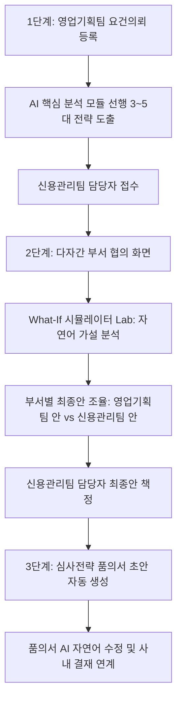

# 🚀 JDBP (젭대리 Biz.Platform)
> **JB우리캐피탈 AI 여신심사전략 협의 및 운영 통합 플랫폼**

[](https://github.com)
[](https://github.com)
[](https://github.com)

---

## 📌 프로젝트 소개 (Overview)

**JDBP (젭대리 Biz.Platform)**는 영업기획팀과 신용관리팀 간의 여신심사 규정 개정 및 전략 수립 프로세스를 혁신하는 금융 의사결정 통합 플랫폼입니다.

기존의 파편화된 메일/메신저 소통과 수작업 데이터 분석을 탈피하여, **18.4만 건의 차주 빅데이터 파레토 프론티어 탐색, 자연어 What-If 가설 시뮬레이션, 다자간 실시간 부서 협의, AI 기반 품의서 초안 자동 작성**을 단일 플랫폼에서 원스톱으로 제공합니다.

---

## 🌟 핵심 워크플로우 (Core Workflow)



### 1. 1단계: 업무요건 의뢰 및 선행 전략 분석
- **영업기획팀**: 상품명, 승인율 최대 허용 하락폭(-3.0%p), 최소 표본 비중(1.0%) 제약조건을 설정하여 업무 의뢰.
- **AI 핵심 모듈 연동**: 신용관리팀 담당자에게 도달하기 전 18.4만 건 빅데이터를 바탕으로 **3~5개의 최적 대안 전략**과 5대 주요 재무/건전성 지표 비교표를 선제 도출.

### 2. 2단계: 다자간 부서 협의 및 What-If 시뮬레이션
- **4대 역할 스위칭**: 영업 담당자(최기획 대리), 신용관리 담당자(이신용 대리), 신용관리 팀장(박신용 팀장), 신용관리 본부장(정리스크 본부장)
- **부서별 최종안 투-트랙 구조**: 복잡한 절충안 카드 대신 **영업기획팀 안**과 **신용관리팀 안**을 명확히 대치.
- **권한 제어**: 영업기획팀은 영업안만, 신용관리팀은 신용관리안만 수정 가능하며, 최종안 책정 권한은 신용관리 담당자에게 전결 부여.
- **What-If 시뮬레이터 Lab**: *"1~2등급 우량차주 예외 적용 시 손익은?"*, *"DTI 32%로 완화하면?"* 등 자연어 질문을 입력하면 실시간으로 연체율/승인율/순익 영향도를 검증하여 부서 안건에 즉시 반영.

### 3. 3단계: 심사전략 품의서 초안 작성 및 AI 자연어 수정
- **초안 자동 완성**: 2단계에서 부서 간 최종 책정된 안건과 협의 이력을 반영하여 정식 결재 문서 초안 자동 구성.
- **AI 자연어 문안 정제**: 품의 제목, 변경 사유, 변경 내용 중 수정할 항목을 체크하고 *"임원보고용으로 두괄식 요약해줘"*, *"리스크 선제 방어 강조해줘"* 등 자연어 지시를 내리면 전·후 비교 화면을 거쳐 최종 승인 반영.
- **원클릭 전자결재 본문 복사**: 사내 그룹웨어 전자결재 양식에 즉시 붙여넣기(Ctrl+V) 가능한 텍스트 클립보드 복사 제공.

---

## 🤖 AI 에이전트 연동 I/O 인터페이스 규격

중간 AI 핵심 모듈을 개발 중인 타 개발자와의 완벽한 협업을 위해 `AiAgentClient` 어댑터 레이어가 내장되어 있습니다.

| Endpoint | Method | 용도 및 호출 시점 |
| :--- | :---: | :--- |
| `/api/v1/ai/pre-analyze` | `POST` | 1단계 접수 시 3~5대 선행 최적 전략 및 5대 지표 비교표 도출 |
| `/api/v1/ai/simulate-whatif` | `POST` | 2단계 What-If Lab 팝업에서 자연어 가설 분석 및 후보안 도출 |
| `/api/v1/ai/refine-draft` | `POST` | 3단계 품의서 문안 자연어 수정 및 재구성 제안 |
| `/api/v1/ai/health` | `GET` | AI 모듈 서버 핑(Ping) 헬스체크 |

- **Dual-Mode 지원**:
  - `MOCK 모드` (기본값): 상대방 모듈 제작 중일 때 완벽한 규격 데이터로 전체 비즈니스 흐름 진행.
  - `API 모드`: 완성된 실서버(`http://localhost:8000/api/v1`)와 HTTP 통신.
  - `Auto-Fallback`: 실서버 미응답 시 Mock 데이터로 자동 대체되어 무중단 시연 보장.
- **실시간 I/O 패킷 검사기**: 화면 상단 GNB에서 패킷 로그 실시간 열람 및 JSON 복사 가능.

---

## 💻 로컬 실행 방법 (Getting Started)

### 전제 조건
- Node.js (v18 이상 권장) 또는 최신 웹 브라우저

### 실행 명령어
```bash
# 로컬 개발 서버 실행 (포트 3000)
node server.js
```

브라우저에서 `http://localhost:3000`으로 접속합니다.

---

## 📁 프로젝트 구조 (Directory Structure)

```
JDBP(JepDaeri_Business_Platform)/
├── index.html        # 메인 진입점 (Tailwind CDN, CSS, Toast 컨테이너)
├── app.js            # 전체 State 머신, 비즈니스 로직, AiAgentClient, 컴포넌트 렌더러
├── server.js         # 로컬 정적 서빙 및 모바일 단말 접속 지원 웹 서버
├── .gitignore        # Git 버전 관리 제외 규칙
└── README.md         # 프로젝트 안내 및 명세서
```

---

## 📄 라이선스 (License)
Copyright © 2026 JB우리캐피탈 (JB Woori Capital). All rights reserved.
